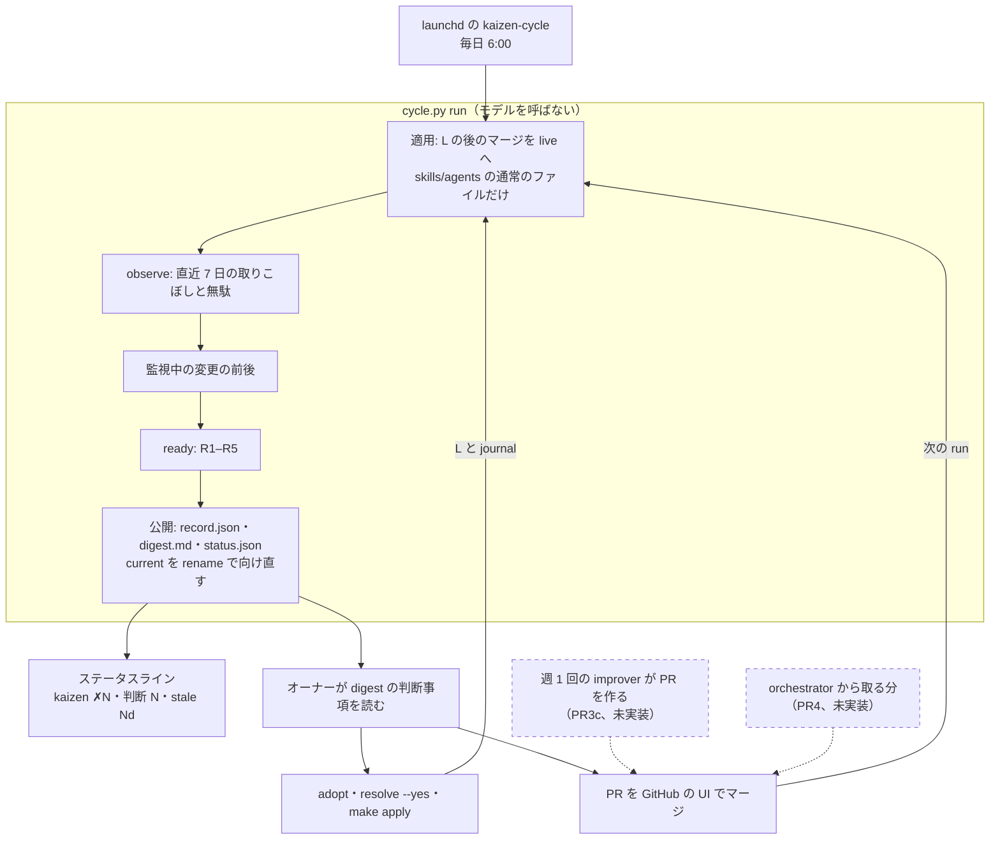

# 設計書: hiden の注意の配分と改善の周期

hiden の source は `home/dot_claude/skills/hiden/`、live は `~/.claude/skills/hiden/` にある。hiden の役目は、能力の高いモデルの注意を配ることにある。規則、台帳、予算、改善の周期は、どれもそのための手段である。

## 全体像

kaizen は、実作業の観測から hiden の注意の配分を少しずつ直す仕組みである。自動で動くのは毎日の周期で、launchd が起動し、モデルを呼ばずに、マージ済みの変更の live への適用、観測、準備状態の検査、digest と判断事項の公開までを行う。オーナーは、digest の判断事項を読んで決め、管理パスに触れる PR を GitHub の UI でマージし、自動の適用が断った変更を自分で適用して越える。作業するセッションは、この仕組みに関わらない（原則 4）。週 1 回の improver が変更を 1 つ選んで PR にする経路（PR3c）と、orchestrator から文を取る PR4 は、まだ入っていない。

| もの | 場所 |
|---|---|
| source | `home/dot_claude/**`（管理パスの一覧は `.claude/kaizen-managed`） |
| live | `~/.claude/`（自動で適用するのは `~/.claude/skills/**` と `~/.claude/agents/**` の既存の通常のファイルだけ） |
| 周期のスクリプト | `scripts/kaizen/`。ジョブは store の写しを走らせるので、変更は次の switch で効く |
| ジョブ | `launchd.agents.kaizen-cycle`（`nix/home/profiles/dev.nix`）、label `org.nix-community.home.kaizen-cycle`、毎日 6:00、期限 20 分 |
| ログ | `~/Library/Logs/kaizen-cycle.log` |
| 公開物 | `~/.claude/kaizen/current/`（`runs/<id>/` へのシンボリックリンク）の `record.json`、`digest.md`、`status.json`。ステータスラインは `status.json` を読む |
| 監視 | 一覧は `scripts/kaizen/watch.json`、前の窓の基準値は `~/.claude/kaizen/watch/<id>.json` |
| 適用の状態 | `~/.local/state/kaizen-apply/` の `applied.json`（適用の位置 L）、`journal.json`、`backup/`、`mirror.git` |

**オーナーのコマンド**（`scripts/kaizen/` の下）:
- `cycle.py adopt <sha>`: 飛ばす候補を示してから、そのコミットを L にする。最初の L を決めるときと、断られた候補を pull と `make apply` で入れた後に使う。
- `cycle.py resolve [--yes]`: 未解決の journal の記録ごとに live と backup を示す。`--yes` のときだけ journal を消し、ファイルには触れない。
- `cycle.py run --no-apply`: 適用を飛ばして、観測から公開までを手で走らせる。
- `apply.py --check`: 写しの fetch のほかは何も書かずに、L、journal、待っている候補を示す。

**判断事項になるもの:** オーナーが直す準備状態の FAIL（R1、R2、`gh auth status` が通らない R4）、読めなかった入力、計算できなかった監視、適用が止まった理由（L が無い、候補を丸ごと断った、衝突、未解決の journal、状態のファイルが読めない）。R3 と R5 の FAIL は digest の準備状態にだけ出る。

詳しくは、証拠は [§2](#2-証拠と配る仕組み)、周期の段と適用と守りは [§6](#6-周期)、PR ごとの中身と完了条件は [§7](#7-pr-の計画) にある。

## 1. 原則

1. **既定は信頼する。** 指示の単位は、それが無いとモデルが落ちる証拠がある所にだけ置く。証拠とは、実際の事故か、床を示した probe のこと。証拠の無い統制はトークンと注意を使い、能力を狭めることがある。
2. **時と場所を合わせて渡す。** 注意は CPU の割り当てに似ている。ただしエージェントは自分を見失うので、出来事で起こす。
   - 常駐させる文は、目的と本質だけにする。
   - 単位は、判断点と段の切り替えで出来事が届ける。
   - references は、要るときに読む。
   - 同じ役割の中でも、段ごとに要る集合が変わり、複数の関心を釣り合わせる。
   - モデル自身に思い出させる文（自己スケジュール）には頼らない。
3. **取り去るのも配分のうちである。**
   - 仕組みにできるものは仕組みに渡す（例: マージは merge-pr）。
   - モデルが既にしている振る舞いの文は消す。
   - 役割が知る必要の無いものは見せない。
   - 問題でないものは直さない。例: 何度もやり取りした後に英語へ流れることは、意図して直さない。
4. **作業するセッションは、注意の管理に注意を使わない。** 観測、振り返り、改善は、別の定期の周期が行う。作業するセッションには、meta の務めも kaizen の文も無い。
5. **検証は、実作業の観測と判断で行う。**
   - transcript から 2 種類を探す。取りこぼした注意（失敗、オーナーの訂正）と、無駄にした注意（一度も起きない単位、要らない露出、手順の手間）。
   - 変更の可否は、Codex とオーナーが判断する。
   - 成果のベンチマークはゲートにしない。モデルが強くなるほど、現実的なベンチマークは長く高くなるからである。
   - 安い注意の分布の probe（§5）は、配るか取るかの判断材料にする。マージのゲートにはしない。
6. **オーナーが握る。**
   - 守りを緩めるのはオーナーだけ。守りとは、許可・破壊・外部・公開の線、フック、merge-pr、hiden の本質を指す。
   - kaizen の PR は、オーナーが GitHub の UI でマージする。
   - オーナーの決定は、週 1 回ほどにまとめる。開いている kaizen の PR は 1 本まで。
   - 1 周期の Claude の費用は 50 ドル相当まで（Codex は別に数える）。周期は 1 日 1 回まで。

## 2. 証拠と、配る仕組み

| 証拠（P はパイロット） | 設計への帰結 |
|---|---|
| P1: 短く整ったケースでは、hiden が無くても Opus は全部通った。進め方 4 の 1 行だけを消すと、hiden が無いときより悪くなった | 成果の合否では配分を比べられない。釣り合う組の行は、片方だけを取らない |
| P2: 実際の判断点の文脈は長く、その長さで成果を試すと 1 周期の上限を大きく超える | 成果のベンチマークは周期に入れない |
| P3: 埋もれた事実は、負荷によらず 100% 拾われた。落ちたのは既定の作法で、負荷によらなかった。作法とは、実際の入力で確かめる、修正を外してテストが落ちるのを見る、確認のラウンドを頼む、の 3 つ | 床は作法の側にある。単位はそこにだけ置く |
| P3: 判断の直前に 1 単位だけ渡す配り方（just-in-time）は、hiden 全体の常駐に一度も負けなかった。worker の「落ちるのを見る」は 5/6 対 0/6 で、全体を常駐させるとこの作法が消えた | 束を常駐させず、判断点で 1 単位を渡す |
| P3: description だけで置いた skill は、merge と format の 6 run で 1 回も呼ばれなかった（worker では試していない） | 床の単位を「必要時」に置かない |
| P3: hiden を配っても、気を散らす物は増えなかった。統制しすぎ仮説の結果は混在した。選択式の状況テストは天井に当たり、答えが行動を予測しなかった | 選択式のテストは使わない。単位を足すのは、床があるときだけ |
| 直近の transcript で、hiden の references は Read と Edit で頻繁に開かれている | 表で名前を挙げた references は、実際に読まれている |

**フックで文脈に入れられるもの**（https://code.claude.com/docs/en/hooks.md）

- `additionalContext` が使えるイベントと、文が届く位置:
  - SessionStart、SubagentStart: 会話の初め。
  - UserPromptSubmit: プロンプトと並べて。
  - PreToolUse、PostToolUse、PostToolUseFailure、PostToolBatch: ツールの結果の隣。
  - Stop、SubagentStop: ターンの終わり。
- PostCompact では入れられない。10,000 字を超える値はファイルとプレビューに置き換わる。
- subagent の中でも同じフックが走り、入力に `agent_id` と `agent_type` が付く（親と子で `session_id` は同じ）。
- ネイティブの subagent では `agents/*.md` の本文が system prompt になり、compaction の要約の対象にならない。
- SessionStart の入力には `source`（`startup`、`resume`、`clear`、`compact`）と `transcript_path` が付く。compaction の後も transcript の先頭には元の最初のプロンプトが残る。
- SubagentStart の文は subagent の文脈に入り、compaction で失われた後は次の発火で入れ直される。
- PreToolUse の文も「結果の隣」に届くので、その呼び出し自体は変えられない（変えられるのは deny、ask、`updatedInput`）。そのため、判断点への配達は直前のツールの結果、つまり PostToolUse に置く。
- docs の勧めに従い、配る文は命令ではなく事実の形で書く。
- T3 の `delegate_task` の子は別のセッションで、`agent_type` は無く、cwd は専用の worktree のことも共有のチェックアウトのこともある。worker の子は、最初のプロンプトの固定の 1 行（`Follow the body of ~/.claude/agents/opus-worker.md`）で見分ける。cwd では見分けない。
- Codex（reviewer）には Claude のフックが届かない。配達点は依頼文だけになる。

## 3. 役割と段ごとの配分

「仮説」と書いたものは、§5 の観測で確かめる。

### 3.1 orchestrator

**常駐:**
- SKILL.md の本質、範囲、進め方 1・3・4・5、references の表、「作業中ずっと」の残り。
- SessionStart で入る items: `essence`、`decide-methods`、`evidence`。
- 進め方 3〜5 と `decide-methods` は、釣り合う組なので手を付けない（P1）。

| 段 | 出来事で渡す | 必要時 | 取る | 証拠 |
|---|---|---|---|---|
| 開始・再開・clear | SessionStart: state.md、items、経路の問い 1 文 | 表から当たる reference | 予算の使用量の行（meta） | 原則 4 |
| compaction | SessionStart(compact): 上の内容と「今の段の reference を読み直す」 | — | 進め方 2「各段に入る前に読み直す」 | 原則 2。効き目は仮説 |
| state が古い | Stop: `watch` が state より新しければ 1 度止める（今の仕組み） | — | — | 既存の仕組み |
| 委任 | — | subagent-brief.md | 報告の仕様にある回帰テストの句（§3.2 へ移す） | P3 |
| 外部を待つ | — | commit-pr.md（SKILL の「外部を待つ」の段落を移す） | SKILL の常駐段落（579 B） | 段に属する判断で、常駐は要らない |
| レビュー・マージ | — | codex-review.md（依頼の書式に、主張ごとに最も強い証拠を求める一文を置く）、commit-pr.md | 「reviewer の常時の項目を依頼文に貼る」 | `evidence` の役目を依頼の書式が引き継ぐ |
| 環境で検証が止まった | — | debugging.md（recall の行を移す） | SKILL の常駐の行 | 仮説 |
| 段の区切り | — | steward（目的と経路の監査が要るときに呼ぶ） | 台帳の記録、振り返り、文書整理、`/wasure` を勧める文、「手法を直すとき」は周期へ移す。steward を呼ぶ定例の時期は消す | 原則 4 |

引き継ぎの文は、今は SessionStart と Stop の両方が同じ `QUESTIONS` から出している。動かすのは両方の出力を一緒に直して確かめるときだけにし、v1 では触らない。

**兆しだけの候補（probe するまで変えない）:**
- format の場面でオーナーに尋ねる率: 全体を常駐 1/3、plain 2/3、just-in-time 3/3。
- merge の前に確認のラウンドを頼む率: plain 2/3、配った腕 3/3。

### 3.2 worker

**常駐:**
- `opus-worker.md`。回帰テストの一文（"A test counts as a regression test only after it has been seen failing with the fix removed and passing with it restored."）を含む。
  - ネイティブの subagent: system prompt になり、compaction の後も残る。
  - T3 の子: 固定の 1 行で読ませる。compaction の後は、最初のプロンプトに固定の 1 行があれば、`orchestration-context.py` の SessionStart(compact) が本文（frontmatter を除く）とそのプロンプトをそのまま文脈へ戻す（フックの上限の長さで切る）。
- CLAUDE.md。
- items の `evidence`。

| 段 | 出来事で渡す | 取る | 証拠 |
|---|---|---|---|
| 開始 | 指示書（作業、当たる束、完了条件）。SessionStart か SubagentStart で worker の items | items の `report`（opus-worker.md と重複）、`carry-through`（CLAUDE.md の Completion と重複）。`scope` は、公開の契約を決める前に尋ねる点を opus-worker.md の範囲の一文に畳んでから消す | 静的な事実 |
| 報告 | opus-worker.md の報告の形 | — | — |

- **見せないもの:** hiden の全体。P3 で、全体を常駐させると作法が消えた。
- **観測:** worker のセッションで hiden が読み込まれた回数を数える。出ていたら、description を orchestrator 専用に絞る（仮説）。
- **届かない形:** 指示書をファイルに置き、プロンプトでは「読んで従え」とだけ書いた T3 の子は、最初のプロンプトに固定の 1 行が無いので、compaction の後に本文が戻らない。

### 3.3 reviewer（Codex）

- **常駐:** 共有テンプレートから描画した Codex の AGENTS.md。
- **出来事:** orchestrator が書く依頼文だけ。中身は、目的、主張の一覧、問い。
- **見せないもの:** hiden、台帳、kaizen のすべて。

### 3.4 周期（cycle）と improver

- **cycle:** モデルを使わないスクリプト（`scripts/kaizen/cycle.py`）で、読む文は無い。出力の digest は、オーナーと improver が読む。
- **improver:**
  - 受け取るのは、cycle が書く指示書（証拠の id、変更 1 つ、変更後に見るもの）。
  - 必要時に読むのは `scripts/kaizen/writing.md`（AGENTS.md の Agent Knowledge Upkeep から移した、書き方と分け方の規則）と writing-for-agents。
  - hiden の source は、編集する対象として読む。
- **作業するセッションに見せないもの:** cycle と improver の文のすべて。

## 4. 最初の変更（証拠の強い順）

1. **worker の回帰テストの単位**（P3。基準を満たした唯一の差）: §3.2 のとおり、opus-worker.md の本文に置き、T3 の子には compaction の後にフックが本文を戻す。指示書の報告の仕様にある同じ句は、本文が届くと確かめた worker についてだけ消す。
2. **作業するセッションから meta の務めを取る**（原則 4）。P3 で全体の常駐が作法を消したことは、間接の裏付けにとどまる。meta の話が混ざる率は増えなかったので、強い証拠ではない。
   - SKILL.md の「手法を直すとき」を消す。
   - retro.md を消す。
   - orchestration.md の台帳と振り返りの行を消す。
   - attention.md の注意の予算の節と、steward を呼ぶ定例の時期を消す（steward は必要時に呼べるまま残す）。
   - 注入から予算の行を消す。
   - description から retrospectives を外す。
   - 台帳が今くれるもの（指摘ゼロのラウンドという分母、見送りの理由、採否と変更の対応、工程の逸脱、後から分かった欠陥の元の PR と検出の工程）は、周期が PR とラウンドを結べる実例を読んで判断する。採否や発言の元を確かめられない証拠は「不明」とし、それに頼る変更だけを見送る。作業するセッションに記録の務めは戻さない。
3. **自己スケジュールを外す**（原則 2。仮説）。
   - 進め方 2 を消す。
   - 「時間を見積もって超えたら調べる」の句を消す。
   - 外部を待つ段落は commit-pr.md へ移す。
4. **重複と、何もしない文を取る**（静的な事実）。
   - items の `report`、`carry-through`。`scope` は opus-worker.md に畳んでから消す。
   - reviewer の項目の行（証拠の要件は codex-review.md の依頼の書式へ）。
   - recall の行は debugging.md へ移す。
   - issue の行は、表の 1 行（scope.md）にする。
5. **問題でないものを source に揃える**: live で既に消えている言語の行を、source にも反映する。

**量の目安:**
- SKILL.md: 9.1 KB から約 6.8 KB。
- attention.md: 3.8 KB から約 1.3 KB。
- retro.md: 3.1 KB を削除。
- hiden 全体: 56.6 KB から約 49 KB。
- items: 6 件から 3 件。
- 足すのは opus-worker.md の 1 文だけ。本文の既存の文を同じだけ削り、上限を上げない。
- 上限は、新しい大きさまで下げる。

## 5. 変更の確かめ方

**PR の前の probe（任意。ゲートではない）**

- 使う場面は 2 つ。
  - 判断点への配達を動かす変更。
  - 釣り合う組の片方を取る変更。
- 方法は P3 と同じ形にする。
  - P3 の道具（build、run-jobs、score）を `scripts/kaizen/probe/` に置いて使う（PR2 で入れる）。
  - grader は事前に登録する。
  - 負荷は L2 の疑似の履歴。
  - 2 腕 × 6 run。短い疑似の履歴なので、1 回の probe は周期の上限の 1 割に収まる。
- 判定の基準は「勝つ側が 5/6 以上」。結果は証拠として PR か提案に付ける。
- 狙うのは作法の床だけにする。埋もれた事実は拾われるので、狙わない。

**マージ後の観測**

- PR ごとに、次の 3 つを書く。
  - 変更が動かすはずの信号。
  - 害を示す信号。
  - 同じスクリプトで過去 30 日の transcript から出した基準値。
- 回帰テストの単位の場合:
  - 動かすはずの信号: テストのファイルを書いた worker のセッションのうち、同じテストが狙った理由で赤になり、修正の後に緑になった例の割合。
  - 害を示す信号: worker のターン数と報告の長さが増える。worker についてのオーナーの訂正が増える。
- 取る変更の場合:
  - 消した振る舞いに触れるオーナーの訂正を見る。
  - meta の手間が 0 に近づくかを見る。手間は、台帳、retro、予算への 1 セッションあたりのツール呼び出しで数える。
- 無駄を見る: 出来事で配る単位ごとに、配る機会（各 worker で照合に当たる最初の出来事を 1 機会とする）の数を分母にして、配られた数を transcript の注入の記録から数える。機会があったのに配られていなければ照合を直し、機会が 0 なら「未観測」とする。専用の配達ログは、要ると分かってから足す。

**正直な限界**

- 該当するセッションは少ない。検定はせず、数と元の行を数件並べる。
- 向きを言うのは、2 週以上かつ該当 10 件以上たまってから。はっきりした事故が 1 件あれば、revert を提案するには足りる。
- 信号は regex とツール呼び出しで作るので粗い。元の行を 3 件出して、意図した項目を数えていることを確かめる。
- 観測は窓が閉じたら外す。規則ごとの常設の telemetry は置かない。

## 6. 周期

**起動:**
- Home Manager の `launchd.agents.kaizen-cycle`（`nix/home/profiles/dev.nix`）が、毎日 6 時に `scripts/kaizen/cycle.py` を store の写しから走らせる。スクリプトの変更は次の switch で効く。ログは `~/Library/Logs/kaizen-cycle.log`。
- 眠っていて逃した時刻の分は、起きたときに 1 回走る（launchd.plist(5) の StartCalendarInterval）。launchd は同じ label のジョブを同時に 2 つ走らせない。
- 1 回の run は状態を持たない。毎回、直近 7 日の窓 [今 − 7 日, 今) を入力から計算し直し、どの入力も窓の中の観測だけを数える。前回の位置（watermark）は持たず、書きかけの最後の行はその回は読まない。run の日付は Asia/Tokyo で数える。ただし、適用の位置（下の「マージの後」の L）だけは `~/.local/state/kaizen-apply/applied.json` に持つ。これは観測の位置ではなく、live がどのコミットまで適用されたかの記録である。
- run 全体に 20 分の期限がある。期限を超えた run は 0 以外で終わるので、次の日の起動は止まらない。launchd はジョブの終わりに同じプロセスグループの残りを止める。手で動かした run が launchd の run と重なっても、公開（書き込み、rename、整理）は `~/.claude/kaizen/.publish.lock` で順番に行う。ロックを待つ間の停止や期限は何も公開せずに終わり、ロックを取った後に来たものは公開が済んでから効く（そのときだけは公開してから 0 以外で終わる）。

**毎日の段（費用 0。モデルを呼ばない）:**

最初に、下の「マージの後」の適用を行う（`cycle.py run --no-apply` で飛ばせる）。適用が失敗しても、次の段と公開は続ける。

1. `scripts/kaizen/observe.py` が、窓の中の取りこぼしと無駄の候補を集める。入力が 1 つ失敗しても、ほかの入力は読む。開くのは通常のファイルだけで、FIFO やシンボリックリンクは読めない入力として数える。
   - 入力: transcript（`~/.claude/projects/` の下の親と子の `*.jsonl`。文字列の user レコードにも合成の入力があるので、オーナーの発言は起源を確かめられたものだけを数える）、T3 Code の DB（T3 が走らせたセッションのオーナーの発言はここからだけ数える）、`~/.codex/sessions`、既存の台帳（読むだけ。行の日付は Asia/Tokyo の日で、その日の始まりが窓に入る行を数える）、`gh`（revert、PR を名指す修正 PR、CI の失敗）。
   - T3 の DB は `mode=ro` で開く。SQLite はそれでも DB の横に `-wal` と `-shm` を作ることがあるが、T3 が閉じているときに読み手が作る `-wal` は空で、`-shm` は WAL の索引だけを持つ。こちらの行は入らないので受け入れる。`immutable=1` はそれを避けるが、WAL にまだ残る行を読み落とすので使わない。
   - オーナーの短い返答は、ラベルを付けない候補として数と元の行を出す。
2. 監視中の変更（`scripts/kaizen/watch.json`）について、§5 の観測を足す。
   - 前の窓は [適用 − 30 日, 適用]、後の窓は [適用, 今]。transcript は既定で 30 日後に消えるので、`cycle.py baseline <id>` が適用の直後に前の窓の集計を `~/.claude/kaizen/watch/<id>.json` に 1 度だけ書き、毎日の run はそれがあれば使う。無ければ窓から計算し、一部が消えていると示す。
   - 適用をまたいで動いた worker は、両方の窓に入る。
3. `scripts/kaizen/ready.py` で準備状態を確かめる（下の表）。毎日の段は直さず、オーナーが直す FAIL（表の「FAIL のとき」の列）を判断事項にする。
4. 出力（`record.json`、`digest.md`、`status.json`）を新しいディレクトリ `~/.claude/kaizen/runs/<id>/` に書き、シンボリックリンク `~/.claude/kaizen/current` をそこへ向け直す rename 1 回で、run 全体を一度に公開する。読み手（オーナー、ステータスライン、次の run）は `current` を通して読む。公開の後、公開した run と直前の run 以外の run ディレクトリを消す。
   - 公開の前に失敗した run、止められた run、期限を超えた run は何も公開せず、`current` は前回のままになる。古い run を消せなかったときは、ログに残して公開はそのままにする。ステータスラインはその時刻から stale を示す。
   - 入力が読めなかった run は、その入力を fail と記して公開する。R4 の FAIL と判断事項に出る。

**週 1 回の段（PR3c で入れる。開いている kaizen の PR が無いときだけ。10〜30 ドル）:**

5. improver を `git wt --nocd` で作った worktree で `claude -p --max-budget-usd <残り>` として走らせ、証拠から変更を 1 つ選ばせる。直しの順は、仕組み、出来事での配達、文を消す、文を足す。返すのは成果物（差分と「見るもの」）だけで、push はしない。
6. 必要なら §5 の probe を走らせる。Codex のレビュー（role review）では、失った判断、緩んだ守り、事例専用の名詞を問う。
7. 自動で公開するのは、差分も、コミットのメッセージも、PR の題・本文・ブランチ名も、公開の資料だけで説明できるものに限る。非公開の証拠（オーナーの発言、非公開のリポジトリの事故）を読んで作ったか、由来がはっきりしないものは、`~/.claude/kaizen/proposals/` に置くだけにする。公開するものは、送るコミットの範囲とメタデータを固定してから公開の検査を通し、親が push して PR を作る。観測の元の行と非公開の結果は digest に残す。
8. digest（`~/.claude/kaizen/current/digest.md`）を、現状だけを書く形で上書きする。毎日の段でも書く（上の 4）。中身は次のとおり。
   - 準備状態。
   - 適用（L とその由来と時刻、未解決の journal、候補ごとの結果）。待っている候補が無くても L と journal は出す。
   - 取りこぼしと無駄（数と元の行）。
   - 監視中の変更の経過。
   - 判断事項（証拠、推奨、費用）。権限の外にある欠けは、ここで提案にする。
   - 費用の実績。
   - ステータスラインに `kaizen ✗N・判断 N・stale Nd` を出す。stale は、最後に完了した run が 36 時間より古いとき。

**記録と費用:**
- `record.json` に、run の日付、窓、入力ごとの読んだ数と結果、候補の全件、準備状態、適用の結果、監視、判断事項、費用を書く。
- 費用: Claude の子は残りを上限として渡せる経路だけで走らせる（improver は `claude -p --max-budget-usd`、probe は `claude plugin eval --max-cost-usd`）。上限を渡せない段は走らせず判断事項にする。Codex のレビューは Claude の予算の外で数え、digest に回数を出す。

**マージの後（適用）:**
- **対象（v1）:** `home/dot_claude/skills/**` と `home/dot_claude/agents/**` の、既にある通常のファイルの変更だけ。パスのどの部分も chezmoi の接頭辞（`dot_`、`executable_`、`private_`、`create_`、`modify_`、`symlink_`、`exact_`、`literal_` など）を持たず、`.` で始まらず、`.tmpl` や `.age` で終わらない。ターゲットは `~/.claude/<残りのパス>`、中身は git の blob、モードは 0644 になる。chezmoi は呼ばない。この形のファイルでは、描画の結果が blob そのものだからである。
- **適用の元:** オーナーのチェックアウトは使わない。周期が持つ bare の写し `~/.local/state/kaizen-apply/mirror.git` に、チェックアウトの GitHub の origin から作った公開の HTTPS の URL で main を fetch する。git の環境は空から組み（`PATH`、`HOME`、`LANG`、`GIT_CONFIG_GLOBAL=/dev/null`、`GIT_CONFIG_NOSYSTEM=1`、`GIT_TERMINAL_PROMPT=0`）、資格情報は使わない。git は自分のプロセスグループで走らせ、時間切れや中断ではグループごと止める。fetch した main をその run の間は固定する。チェックアウトから読むのは origin の URL だけなので、チェックアウトが汚れていても遅れていても結果は変わらない。
- **順番:** 適用の位置 L から main の第一親をたどる。管理パスの一覧のうち `home/` の下のパスに触れるコミットを候補とし、触れないコミット（文書だけ、`scripts/` だけ、依存の更新など）は通す。候補は古い順に 1 つずつ扱い、適用できない候補で止まる。後の候補は、その前の候補を含むので、飛ばして書くと誰もレビューしていない組み合わせになるからである。適用の段は、始まってから 300 秒か、run の期限の 240 秒前（observe から公開までに残す時間）の早い方で終わる。git の呼び出しはどれもこの残りの時間で区切る。過ぎたら次の候補にも次のターゲットにも進まず、書いた分と journal を残し、L は進めずに次の run が続ける。
- **候補を丸ごと断る条件:** 第一親との差分（`git diff -z --no-renames --name-status`）に、上の対象の変更以外のパスが 1 つでもある（追加、削除、テンプレート、属性、settings、seed、`.chezmoiignore` や `.chezmoiremove`、共有テンプレート、管理パスの一覧、chezmoi の設定が使う `scripts/` を含むほかのパス）。chezmoi が読まないリポジトリだけのパス（`docs/`、`tests/`、`.github/`、`scripts/kaizen/`、ルートの `README.md`・`AGENTS.md`・`CLAUDE.md`）は、一緒に変わっていても断る理由にならない。第一親か候補で、そのパスが `100644` の blob でないか、空白だけの中身である。候補の時点で `.chezmoiroot` が `home` でない、`.chezmoi.toml.tmpl` が `umask` に触れる、`home/` の ignore か remove のファイル（`.chezmoiignore`、`.chezmoiremove` と、それぞれの `.tmpl`）の行がターゲットかその上のディレクトリに当たる、それらのファイルのどこかに `{{` がある（条件やコメントだけのアクションでも行をつないだり作ったりでき、`#` の後ろでも動く）、照合が扱わない記法（`{`、`}`、`[`、`]`、`\`、語の途中の `#`）のパターンがある、途中のディレクトリに ignore か remove のファイルがある、同じターゲットになる別のソース（`literal_X`、`X.tmpl` など）がある。これらの条件の下でだけ、chezmoi と同じ結果だと言える。
- **ターゲットごとの判定:** live が 0644 の通常のファイルで、中身が候補の blob と同じなら済み、第一親の blob と同じなら書く。ほか（オーナーやセッションの編集、無い、シンボリックリンク、別のモード、シンボリックリンクを通る親）は衝突で、候補のどのターゲットも書かない。候補が変えないターゲットの編集は、止める理由にならない。
- **書き方:** 新しい中身 B を `~/.local/state/kaizen-apply/backup/<run>/<候補>/<ターゲット>` に書いて fsync し、journal（`journal.json`）に記録してから、`$HOME` から親ディレクトリを 1 段ずつシンボリックリンクを辿らずに開き直し、親が判定のときと同じ（dev, ino）であることを確かめる。そのうえで `renameatx_np(RENAME_SWAP)` で B と live を入れ替える。入れ替えで外れた元の inode は、そのまま backup の名前に残る。その中身が第一親の blob と同じ 0644 の通常のファイルで、親も変わっていなければ、その記録は済みになる。違えば、live がまだ B のときだけ入れ替えを戻し、どちらの版も名前を持ったまま残して止める。live の inode を消すことはしない。親の確認と入れ替えのシステムコールの間は防げない。確認より前に親を動かされたら入れ替えず、置いた B を消して判断事項にする。確認の後に動かされたら、入れ替えは動いた先のディレクトリに入る。それは入れ替えの後に `$HOME` から辿り直して見つけ、記録を未解決にして L を進めない。どちらの場合も、どの版にも名前が残る。適用した後にもう一度 `$HOME` から辿り、候補の全ターゲットが候補の blob と同じで、journal の親が変わっていないときだけ L を進める。1 つのターゲットの書き込みの間は SIGTERM と SIGALRM を待たせる。
- **自動では戻さない:** 途中で止まった候補は、書いたターゲットをそのまま残し、次の run がそれを済みとして続きを書く。前の run が書いたターゲット（その候補の journal に済みの記録があるもの）は、書く対象を決めるのと同じ読み取りで判定し、もう一度書く対象には入れない。`$HOME` から辿った親が同じで live が候補の blob の 0644 なら済み、ほか（オーナーが第一親の版に戻した、別の版にした、親が変わった）はその記録を未解決にして何も書かない。戻すのは、入れ替えの直後に元の中身が違うと分かった 1 つのファイルだけである。入れ替えの前から fd を開いたままの書き手が後で書く分は、backup の inode に入る。これは受け入れ、確かめない。
- **journal と resolve、adopt:** 済みでない journal の記録があると、run は何も書かず L も進めず、各記録の live と backup のパスを判断事項にする。`cycle.py resolve` は記録ごとに両方のパスの種類、モード、sha256 を示し、`--yes` のときだけ journal を消す（ファイルには触れない）。その後はターゲットごとの判定で決まり、backup に残った編集を自動で戻すことはない。`cycle.py adopt <commit>` は、journal が片付いていて、そのコミットが固定した main の第一親の上で L より後（L が無いときは第一親の上のどこでも）にあるときだけ、飛ばす候補ごとに対象になるパスの判定と断る理由になるパス、ほかのパス、L との違いを示して、そのコミットを `by: owner` で L にする。そのコミットまでの候補の済みの記録は消し、後の候補の記録は残す。断られた候補は、オーナーが pull と `make apply` をしてから `adopt` で越える。
- **最初の L:** `applied.json` が無いときは何も書かず、live が main と違うターゲットを並べて `cycle.py adopt <main>` を判断事項にする。
- `.apply.lock` を持つ run、`adopt`、`resolve` だけが書く。ロックを取れなかった run も、L と未解決の journal は読んで示す。未解決の journal は fetch の前に判断事項にするので、fetch の失敗で隠れない。`applied.json` と `journal.json` はシンボリックリンクを辿らず待たずに開き、通常のファイルで apply の書く形（文字列、16 進の sha、`..` を含まない相対パス）のときだけ使う。そうでなければ何も書かず判断事項を 1 つにし、もう一方のファイルはそのまま読み、公開は続ける。backup は v1 では消さない。
- `scripts/kaizen/apply.py --check` は確かめるだけのコマンドで、写しの fetch のほかは何も書かずに、L、journal、待っている候補を示す。予測するのは次の候補（適用するか、どこで止まるか）だけで、その後の候補は今の live と比べた参考として示し、終了コードに入れない。参考を作る途中で失敗しても、その行を示すだけで終了コードは変えない。読めない状態と未解決の journal は fetch の前に示す。`adopt` と `resolve` は `cycle.py` のコマンドである。
- R1 とステータスラインの差分の表示はチェックアウトを元に比べるので、正しく適用した後でも、オーナーのチェックアウトが遅れている間は差分を示すことがある。
- items.json は通常の管理ファイルにする（`create_` の seed をやめる）。これで書き手は source の 1 か所になる。

| ID | 準備状態（モデルが最善を出せる注意の環境か。それを確かめられるか） | 検査 | FAIL のとき |
|---|---|---|---|
| R1 | 管理パスの一覧に入るソースの全ターゲット（自動の適用の対象より広い）の live が source と一致する | それに絞った `chezmoi diff`（chezmoi に設定されたチェックアウトの一覧で絞る。`.chezmoiremove` の消し待ちも含む。worker の規則を運ぶ opus-worker.md の本文と settings のフック登録も対象なので、配達の準備もここで見る） | 判断事項（apply はこの検査を使わない） |
| R2 | 周期が起動される | `launchctl print gui/<uid>/<label>` でジョブが読み込まれており、その program と引数の絶対パスが在る | owner |
| R3 | 常駐の量が上限内にある | `attention-budget.py status` に OVER が無い | improver の候補 |
| R4 | 観測できる | その run の observe で各入力が読めた（gh は切ってもよい）。`gh auth status` が通る | 認証は owner |
| R5 | 周期が生きている | 公開中の run（今の run が公開する前の `current`）が 3 日以内に完了した。開いている kaizen PR が 14 日以内 | digest |

検査が呼ぶコマンドには、それぞれ時間の上限がある。上限を超えたか、見つからないか、失敗したコマンドは、その検査の FAIL にする。

作業するセッションの文に meta の務めが戻っていないかは、文を変える差分のレビューで見る（語の一覧での検査は言い換えを拾えないので置かない）。

「最善を出しているか」は、機械では確かめられない。digest で観測の推移を見せるにとどめ、確かめたとは書かない。

**守り:**
- **管理パスの一覧:** `.claude/kaizen-managed` に置く。中身は次のとおり。
  - `home/dot_claude/**`
  - `home/.chezmoiignore`、`home/.chezmoiremove`、`home/.chezmoitemplates/agents/**`
  - `scripts/kaizen/**`、`docs/kaizen.md`
  - 一覧そのもの
- **merge-pr:** GitHub 上の PR の base を確かめ、一覧をその base から読み（`git show <base>:...`）、一覧に触れる PR を、誰の依頼でも拒否する。dotfiles で一覧が読めないときも拒否する。管理パスに触れない PR は今までどおり通す。
- **オーナーのマージの手順:** `main` の必須チェック `automerge-gate/all-passed` は、auto-merge が有効になるか、作者以外の承認があるときに走る。オーナーは自分の PR を承認できないので、確かめた head で GitHub の UI から auto-merge を有効にする。その後、周期はその PR に push しない。head を更新するときは、先に UI で auto-merge を解除し、新しい head を確かめてから有効にし直す。
- **Codex:** Codex のセッションには Claude のフックが届かず、merge-pr の拒否も通らない。v1 の Codex はレビューだけを担い、マージの作業を渡さない。Codex と pi の作業指示（`home/dot_codex/AGENTS.md.tmpl`、`home/dot_pi/agent/AGENTS.md.tmpl`）に、管理パスの PR はオーナーだけがマージすることを一文で置く。Claude には merge-pr の拒否が効くので、常時読む指示には置かない。
- **公開の検査:** `scripts/kaizen/public-check` を、push と `gh pr create`/`edit` の前に走らせる。対象は、送るコミットの範囲の全コミット（差分とメッセージ）と、PR の題・本文・ブランチ名。ローカルのパス、`host.toml` の値、`~/.claude/kaizen/private-terms` を拒否する。辞書に無い私的な語はこの検査では拾えないので、それは上の段 7 の「公開の資料だけで説明できるものに限る」で防ぐ。
- **auto-merge:** 周期の側の仕組みは持たない。

## 7. PR の計画

PR はすべてオーナーが UI でマージする。

| PR | 中身 | 完了条件 |
|---|---|---|
| PR0（オーナーの作業） | live と source のずれを、`/wasure` の hiden の差分の判定だけを使って解消する | オーナーが採った差分が source に入り、hiden、agents、items の承認済みの対象で live と source が一致する |
| PR1 | 守り: 管理パスの一覧、merge-pr の拒否、公開の検査、AGENTS.md の一文 | merge-pr が拒否する: 一覧の各種のパス（`home/.chezmoiremove`、`home/.chezmoiignore` を含む）に触れる試験 PR、一覧そのものを直す PR、一覧が読めない場合。管理パスに触れない PR は通る。公開の検査が拒否する: 途中のコミットだけにあるローカルのパス、PR 本文だけにあるローカルのパス。オーナーが UI で auto-merge を有効にして必須チェックが走ることを、この PR 自身で確かめる |
| PR2 | 回帰テストの単位: opus-worker.md の本文の一文、`orchestration-context.py` の SessionStart(compact) で本文と元の指示書を戻す分岐、`scripts/kaizen/probe/`（開始時の注入の腕）と `signals.py` の回帰の信号（照合は `signals.py` が持つ）、items の `report`・`carry-through` の削除と `scope` の畳み込み、items を通常の管理ファイルにする。指示書の句は、本文が届くと確かめた worker についてだけ外す | (1) fixture のテスト: 最初のプロンプトのどこかに固定の 1 行があれば compaction の後に本文と指示書が出て、無いとき、`startup`・`resume` のとき、transcript が壊れているときは出ない。(2) 実際の `claude` のセッションで compaction の後に注入が transcript に残ることを確かめた。(3) 基準値を記録した。(4) budget に OVER が無く、上限を上げていない |
| PR3a | 毎日の周期: `scripts/kaizen/{cycle.py,observe.py,ready.py,watch.json}`、launchd のジョブ、ステータスライン | 入力が読めない run は、その入力を fail として公開し R4 が FAIL になる。公開の途中で失敗した run と、公開を始める前に止められたか期限を超えた run は前回の公開を残し、次の run は通る。読み込まれていないジョブと消えた program で R2 が FAIL になる。digest が毎日出る。observe が実際のログを一度読み切る。費用が 0 |
| PR3b | §6 の条件付きの apply（v1: skills と agents の通常のファイルの変更） | fixture: 第一親の状態のターゲットだけを書いて L を進め、元の inode が backup に残る。候補のターゲットの live の編集、対象外のパスも変える候補、guard に当たる候補は、何も書かずに判断事項にする。候補が変えないターゲットの編集では止まらない。入れ替えの前に保存した編集は入れ替えを戻して両方を残す。最後の確認より前に親を動かされたら入れ替えず、確認の後に動かされたら入れ替えは動いた先に入るが、入れ替えの後に見つけて未解決にし、両方の版に名前が残る。前の run が書いたターゲットが変わっていれば、次の run は何も書かない。入れ替えの後に止まった run は次の run を journal で止める。チェックアウトが汚れていても遅れていても結果は変わらず、チェックアウトは origin の URL のほかは読まない。実際のホームで `apply.py --check` が待っている候補を判定し、チェックアウトに触れない |
| PR3c | 週 1 回の improver と公開の経路（`scripts/kaizen/writing.md` を含む） | 公開の証拠だけで作った変更だけが PR になり、それ以外は提案に残る。Claude の費用の記録が 50 ドル以下 |
| PR4 | orchestrator から取る分（§4 の 2、3、5 と、4 のうち PR2 で済ませた items 以外）。AGENTS.md の Upkeep を「セッションは live の hiden を書き換えない」に直す | PR3a の observe が実際のログを読めた後に出す。fixture のテストが通る。量が §4 の目安に収まり、上限を下げた。Codex のレビューで失った判断が無い。リンクが解決する |

## 8. 退けた案

- 成果のベンチマーク（plugin eval）をゲートにする: 天井効果があり、実際の長さでは周期の上限を大きく超える。
- 実使用で A/B をする: 1 人では検出力が無く、並行するセッションが別の指示で動いてしまう。
- 選択式の状況テスト: 天井に当たり、言うことと行動が食い違う。
- worker に hiden の全体か worker 用の抜粋を常駐させる: P3 で just-in-time に負けた（抜粋との比較は 3 run だけ）。
- 床の単位を description や必要時だけに置く: §2 の P3 の結果。
- PreToolUse で判断点に配る: 文が結果の隣に届くので、その呼び出しを変えられない。
- 回帰テストの一文を、テストのファイルを書いたときに PostToolUse で配る: T3 の `delegate_task` の子に届かず、配った後の compaction で失われる。本文に置けば、ネイティブの subagent では system prompt として残り、T3 の子にはフックが compaction の後に戻せる。
- Stop を止めて、回帰テストを確かめさせる: 1 ターンを使い、届くのが遅い。
- 作業するセッションに観測を書かせる、台帳を残す: 注意を管理するための注意になる。
- 規則ごとの署名の telemetry、版の精密な帰属、一致の統計、役割 × 種類の上限の仕組み: どの原則も必要としない。
- apply のトランザクションと自動の巻き戻し、レートの段階づけ、金額の予約: 適用の前提の確認、上限を渡せる実行経路、1 日 1 回、週 1 回の PR で足りる。
- `chezmoi apply` で適用する、適用のためにチェックアウトを進める: 書く直前の中身を確かめられず、オーナーのチェックアウトを動かしてしまう。
- 1 回の run で候補を 1 つだけ適用する: 1 日に管理パスのマージが何本もあると、待ちが減らない。L から main の先頭までをまとめて適用する: 1 つのターゲットの編集が無関係なマージまで止め、失敗をどの PR のものか示せない。
- v1 で settings、seed、削除、テンプレート、新しいファイルも適用する: 描画と入れ替えの回復の約束が増える。オーナーの `make apply` に任せる。
- GitHub Actions で検証する: CI に、資格情報と非公開の証拠が要る。
